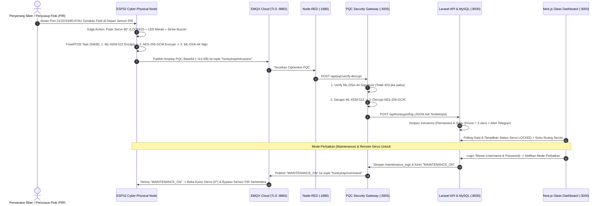

# LAPORAN PROYEK & DOKUMENTASI TEKNIS
## Sistem Honeypot Jaringan & Keamanan Fisik Ruang Server Berbasis IoT dengan Pengamanan Post-Quantum Cryptography (HoneyTrap IoT v3.0)

**Tanggal Penyusunan:** November 2026  
**Versi Sistem:** v3.0 (Cyber-Physical Guard + PQC ML-KEM/ML-DSA/AES-256-GCM + Maintenance & 3H Telemetry Governance)  

---

## BAB 1: PENDAHULUAN

### 1.1 Latar Belakang
Ruang server dan infrastruktur jaringan lokal menghadapi dua ancaman sekaligus: **ancaman siber** (pemindaian port Nmap, *brute-force* SSH/Telnet/FTP, dan eksploitasi web admin) serta **ancaman fisik** (penyusup yang masuk tanpa izin ke ruang/rak server atau sabotase pendingin ruangan). Di sisi lain, pengiriman data telemetri keamanan dari perangkat IoT melalui broker MQTT publik/cloud berisiko tinggi terhadap penyadapan (*eavesdropping*) dan pemalsuan paket (*spoofing*).

**HoneyTrap IoT v3.0** dirancang sebagai **Cyber-Physical Server Room Guard** di atas mikrokontroler **ESP32**. Selain membuka 4 port umpan jaringan (*decoy ports*: 21, 22, 23, 80), perangkat keras ESP32 membaca **Sensor Gerak PIR** untuk mendeteksi penyusup fisik, **Sensor Suhu DHT** untuk memantau temperatur rak server, serta menggerakkan **Motor Servo SG90** untuk mengunci pintu rak server secara otomatis (*Auto-Lockdown*) langsung di *Edge*. Seluruh data yang ditransmisikan dari ESP32 ke server diamankan dengan algoritma **Post-Quantum Cryptography (PQC): ML-KEM-512 + ML-DSA-44 + AES-256-GCM**.

### 1.2 Tujuan Pengembangan
1. Mengimplementasikan sensor *cyber-physical* pada ESP32 yang menggabungkan *Network Honeypot* (Port 21, 22, 23, 80) dengan **Sensor Gerak PIR (`GPIO 32`)**, **Sensor Suhu (`GPIO 4`)**, dan pengunci mekanik **Motor Servo SG90 (`GPIO 13`)** menggunakan pustaka `<ESP32Servo.h>`.
2. Mengamankan jalur transfer telemetri MQTT dari ESP32 ke server menggunakan kombinasi algoritma **ML-KEM-512 (Key Encapsulation)**, **AES-256-GCM (Authenticated Encryption)**, dan **ML-DSA-44 (Digital Signature)**.
3. Membangun **Sistem Peringatan 3 Lapis (3-Tier Alerting)** dan kendali dua arah (*Remote Servo Unlock* & *Maintenance Bypass*).
4. Mengimplementasikan tata kelola operasional ruang server pada Dashboard Next.js dan Laravel MySQL yang meliputi: **Retensi Data Suhu 3 Jam Terakhir**, **Mode Perbaikan Ruang Server Berautentikasi (Username & Password)**, serta **Arsip Log Forensik & Log Perbaikan Berpassword**.

---

## BAB 2: ARSITEKTUR SISTEM & KEAMANAN POST-QUANTUM

### 2.1 Alur Kerja End-to-End & Enkripsi PQC



### 2.2 Spesifikasi Pemetaan Pin Perangkat Keras (ESP32 Pinout)

| Komponen | Pin ESP32 | Fungsi pada Sistem Cyber-Physical |
| :--- | :---: | :--- |
| **Sensor Gerak PIR (`HC-SR501`)** | `GPIO 32` (`D32`) | Mendeteksi gerakan penyusup fisik di ruang server (di-bypass saat Mode Perbaikan aktif) |
| **Motor Servo (`SG90`)** | `GPIO 13` (`D13`) | Pengunci mekanik pintu rak server dengan `<ESP32Servo.h>` (`0°` = Terbuka, `90°` = Terkunci) |
| **Sensor Suhu (`DHT11/DHT22`)** | `GPIO 4` (`D4`) | Memantau suhu & kelembapan rak server (`Port 997` rutin, `Port 998` jika > 35°C) |
| **LED Hijau** (+ Resistor 220Ω) | `GPIO 25` (`D25`) | Indikator status **SAFE (Aman & Kunci Servo Terbuka `0°`)** |
| **LED Kuning** (+ Resistor 220Ω) | `GPIO 26` (`D26`) | Indikator status **WARNING** (Probe Port 21/23 atau Suhu Rak > 35°C) |
| **LED Merah** (+ Resistor 220Ω) | `GPIO 27` (`D27`) | Berkedip cepat (250ms) saat **CRITICAL** (Port 22/80 atau Penyusupan Fisik PIR) |
| **Passive Buzzer** | `GPIO 14` (`D14`) | Bunyi *Beep* tunggal (`1800 Hz`) saat `WARNING` & Sirine 2 Nada (`2800/1800 Hz`) saat `CRITICAL` |
| **Tombol Reset Lokal** | `GPIO 0` (`BOOT`) | Mereset alarm fisik dan membuka kunci Servo kembali ke `0°` secara lokal |

---

## BAB 3: IMPLEMENTASI PERANGKAT LUNAK, KRIPTOGRAFI & TATA KELOLA DATA

### 3.1 Implementasi Kriptografi Post-Quantum (ML-KEM-512 + ML-DSA-44 + AES-256-GCM)
1. **Pembangkitan Kunci ([`pqc-gateway/keygen.mjs`](file:///c:/laragon/www/honeytrap-iot/pqc-gateway/keygen.mjs)):**
   Menghasilkan pasangan kunci **ML-KEM-512** milik server (`Public Key` 800 byte ditanamkan di [`esp32_honeytrap/pqc_keys.h`](file:///c:/laragon/www/honeytrap-iot/esp32_honeytrap/pqc_keys.h)) dan pasangan kunci **ML-DSA-44** milik ESP32 (`Secret Key` 2.560 byte di ESP32, `Public Key` 1.312 byte di [`pqc-gateway/keys.json`](file:///c:/laragon/www/honeytrap-iot/pqc-gateway/keys.json)).
2. **Enkripsi & Penandatanganan di ESP32 (`pqcWorkerTask` pada [`esp32_honeytrap.ino`](file:///c:/laragon/www/honeytrap-iot/esp32_honeytrap/esp32_honeytrap.ino)):**
   * Karena algoritma tanda tangan polinomial **ML-DSA-44** membutuhkan memori *stack* sekitar 45–50 KB (melebihi *stack* `loopTask` standar Arduino sebesar 8 KB), proses kriptografi dieksekusi di dalam **FreeRTOS Task khusus (`xTaskCreate` dengan alokasi `57.344` byte / 56 KB)** yang langsung menghapus dirinya sendiri (`vTaskDelete(NULL)`) setelah selesai.
   * **Tahap 1 (`ML-KEM-512 Encaps`):** Memanggil `PQCLEAN_MLKEM512_CLEAN_crypto_kem_enc()` untuk menghasilkan `kem_ct` (768 byte) dan kunci sesi `shared_secret` (32 byte / 256-bit).
   * **Tahap 2 (`AES-256-GCM Encrypt`):** Memanggil akselerator perangkat keras `mbedtls_gcm_crypt_and_tag()` menggunakan `shared_secret` dan `iv` acak 12-byte untuk mengenkripsi JSON telemetri menjadi `aes_ct` dan `tag` (16 byte).
   * **Tahap 3 (`ML-DSA-44 Sign`):** Menandatangani gabungan `(kem_ct || iv || aes_ct || tag)` menggunakan `PQCLEAN_MLDSA44_CLEAN_crypto_sign_signature()` sehingga menghasilkan `sig` (2.420 byte).
3. **Verifikasi & Dekripsi di Server ([`pqc-gateway/server.mjs`](file:///c:/laragon/www/honeytrap-iot/pqc-gateway/server.mjs)):**
   Menerima amplop Base64 pada `POST /api/pqc/verify-decrypt`, memverifikasi tanda tangan dengan `ml_dsa44.verify()`, melakukan dekapsulasi kunci dengan `ml_kem512.decapsulate()`, dan mendekripsi payload dengan `crypto.createDecipheriv('aes-256-gcm')` sebelum meneruskannya ke Laravel.

### 3.2 Kendali Motor Servo SG90 & Sensor Fisik di Edge
* **Kendali PWM Servo (`<ESP32Servo.h>`):** Sesuai standar frekuensi kerja Servo SG90 (50 Hz, periode 20 ms), fungsi `moveServoAngle()` mengalokasikan Timer 2 (`ESP32PWM::allocateTimer(2)`), memanggil `myServo.attach(PIN_SERVO)` dan `myServo.write(angle)` (`0°` saat aman, `90°` saat mengunci), lalu memanggil `myServo.detach()` setelah 450 ms agar arus USB tetap stabil saat antena Wi-Fi mentransmisikan paket PQC.
* **Deteksi Gerak PIR Anti-Bising:** Menggunakan `INPUT_PULLDOWN`, pendeteksian transisi *Rising-Edge (`LOW -> HIGH`)* dengan filter durasi 180 ms, serta pengabaian otomatis ketika `maintenanceMode == true`.

### 3.3 Mode Perbaikan, Retensi Suhu 3 Jam & Proteksi Log ([`IntrusionController.php`](file:///c:/laragon/www/honeytrap-iot/app/Http/Controllers/IntrusionController.php) & [`page.tsx`](file:///c:/laragon/www/honeytrap-iot/frontend/src/app/page.tsx))
1. **Retensi Suhu 3 Jam Terakhir (`server_temperatures`):** Setiap kali data suhu masuk atau diambil melalui `/api/honeypot/temperatures`, Laravel mengeksekusi `DB::table('server_temperatures')->where('created_at', '<', now()->subHours(3))->delete()` sehingga database hanya menyimpan riwayat suhu 3 jam terakhir.
2. **Mode Perbaikan Berautentikasi (`POST /api/honeypot/maintenance`):** Memvalidasi Username & Password teknisi, menyimpan catatan ke tabel `maintenance_logs` (`START_MAINTENANCE` / `END_MAINTENANCE`), serta menembakkan perintah MQTT `MAINTENANCE_ON` / `MAINTENANCE_OFF` ke ESP32.
3. **Proteksi Password Arsip Log (`POST /api/honeypot/verify-logs`):** Tab *Forensic Logs* di Dashboard hanya dapat dibuka setelah memasukkan password teknisi/admin yang valid, menampilkan tabel **Log Perbaikan Ruang Server** dan **Arsip Serangan Siber & Fisik**.

---

## BAB 4: PENGUJIAN & HASIL EKSPERIMEN

### 4.1 Bukti Pengujian Pemindaian Port (Nmap) & Telemetri Fisik PQC
1. **Hasil Pemindaian Nmap pada IP ESP32:**
   ```text
   PORT   STATE SERVICE
   21/tcp open  ftp
   22/tcp open  ssh
   23/tcp open  telnet
   80/tcp open  http
   ```
2. **Bukti Log Serial Monitor ESP32 (Deteksi PIR + Servo Lockdown + Enkripsi PQC):**
   ```text
   [PHYSICAL BREACH] Sensor Gerak PIR mendeteksi penyusup baru di dekat Rak Server!
   [SERVO] myServo.write(90) -> (LOCKED / TERKUNCI)
   [ALARM] Status KRITIS (CRITICAL) - LED Merah, Buzzer & SERVO LOCKDOWN (90 deg) Aktif!
   [INTRUSION] PHYSICAL-PIR -> Port 999 | Payload: PHYSICAL BREACH: Motion detected at Server Rack -> Servo LOCKED [90 deg] | Temp: 26.4C
   [PQC] Mengenkripsi & menandatangani paket (Free heap: 164764 bytes)...
   [MQTT+PQC] Terkirim (4618 bytes): SUKSES!
   ```

### 4.2 Tabel Hasil Pengujian Fungsional End-to-End

| No | Skenario Pengujian | Aksi / Perintah Uji | Respons Edge ESP32 (LED, Buzzer, Servo, PQC) | Respons Server & Dashboard Web | Hasil |
| :-: | :--- | :--- | :--- | :--- | :-: |
| 1 | Kondisi Awal (`SAFE`) | ESP32 Booting & Konek Wi-Fi | LED Hijau ON, Buzzer OFF, **Servo `0°` (Unlocked)** | Status `SAFE`, `Rack Servo: UNLOCKED (0°)` | **LULUS** |
| 2 | Serangan Siber `WARNING` (Port 21/23) | Koneksi FTP / Telnet ke ESP32 | Banner menampilkan suhu rak server, LED Kuning ON + 1x Beep, Enkripsi PQC | PQC Verified (`true`), Layar Kuning (`WARNING`) | **LULUS** |
| 3 | Serangan Siber `CRITICAL` (Port 22/80) | Akses SSH / HTTP Admin ESP32 | LED Merah Kedip + Sirine Buzzer + **Servo Mengunci `90°`**, Enkripsi PQC | PQC Verified (`true`), Layar Merah (`CRITICAL`), `Servo: LOCKED (90°)` | **LULUS** |
| 4 | Penyusupan Fisik (`PIR Motion`) | Gerakan di depan Sensor PIR (`D32`) | **Servo langsung mengunci `90°`**, Sirine aktif, kirim `PHYSICAL-PIR (:999)` via PQC | Layar Merah (`CRITICAL`), muncul `PHYSICAL-PIR (:999 PIR Motion)` | **LULUS** |
| 5 | Uji Sabotase Paket PQC (`Tampering`) | Inject paket dengan ubahan 1 huruf pada `aes_ct`/`sig` di Node-RED | — | Ditolak `403 Forbidden` oleh PQC Gateway (`ML-DSA-44 Signature INVALID!`) | **LULUS** |
| 6 | Mode Perbaikan Ruang Server | Klik *Mode Perbaikan* di Web -> Login Username & Password teknisi | Terima `MAINTENANCE_ON`, **Sensor PIR di-bypass (tidak bunyi saat ada gerakan)** | Status *Mode Perbaikan: AKTIF*, tercatat di tabel `maintenance_logs` | **LULUS** |
| 7 | Remote Unlock & Reset Alarm | Klik *Acknowledge & Unlock Servo* di Web | Terima `SAFE`, **Servo berputar kembali ke `0°`**, Buzzer mati, LED Hijau ON | Layar kembali `SAFE` dan `Servo: UNLOCKED (0°)` | **LULUS** |
| 8 | Retensi Suhu 3 Jam & Proteksi Log | Cek kartu suhu & buka tab *Forensic Logs* | ESP32 mengirim suhu rak server secara berkala | Suhu > 3 jam otomatis terhapus; Tab Log wajib masukkan password untuk dibuka | **LULUS** |

---

## BAB 5: KESIMPULAN

1. **Integrasi Cyber-Physical yang Utuh:** Penambahan **Sensor Gerak PIR**, **Sensor Suhu DHT**, dan aktuator pengunci mekanik **Motor Servo SG90 (`<ESP32Servo.h>`)** menjadikan ESP32 sebagai perangkat *Cyber-Physical Server Room Guard* yang bekerja secara otonom di *Edge* baik saat terhubung maupun terputus dari internet.
2. **Keamanan Transfer Standar Post-Quantum NIST:** Implementasi **ML-KEM-512 + ML-DSA-44 + AES-256-GCM** melalui *FreeRTOS Task* (56 KB stack) di ESP32 dan **PQC Security Gateway** di server berhasil mengamankan kerahasiaan, keutuhan, dan keaslian sumber data dari ancaman penyadapan maupun pemalsuan paket di broker cloud.
3. **Tata Kelola Operasional Ruang Server:** Fitur **Mode Perbaikan Berautentikasi**, **Proteksi Password Arsip Log**, serta **Retensi Suhu 3 Jam Terakhir** memastikan sistem siap digunakan pada skenario operasional ruang server nyata tanpa memicu alarm palsu saat teknisi bertugas.
