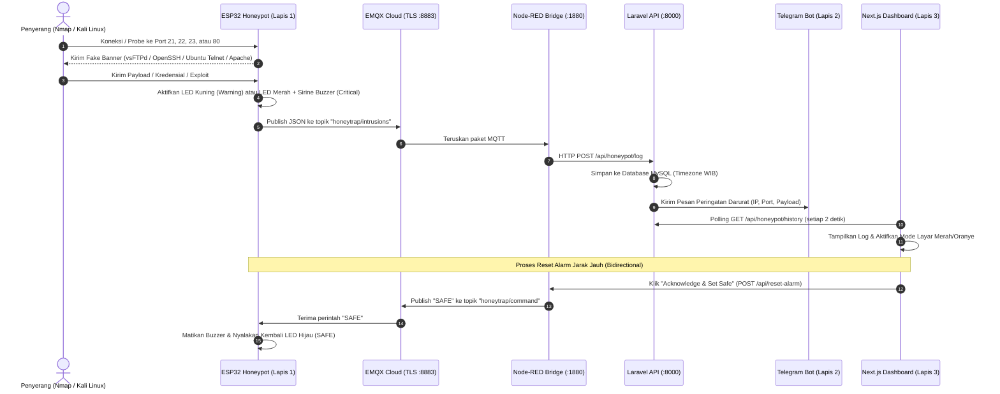

# LAPORAN PROYEK & DOKUMENTASI TEKNIS
## Sistem Honeypot & Deteksi Intrusi Jaringan Lokal Berbasis IoT (HoneyTrap IoT)

**Tanggal Penyusunan:** November 2026  
**Versi Sistem:** v2.0 (End-to-End Integrated Release)  

---

## BAB 1: PENDAHULUAN

### 1.1 Latar Belakang
Jaringan lokal (Wi-Fi kantor, kampus, maupun rumah) sering kali menjadi sasaran empuk serangan siber internal maupun pergerakan lateral (*lateral movement*), seperti pemindaian port (*port scanning* dengan Nmap), percobaan *brute-force* kredensial layanan jarak jauh (SSH, Telnet, FTP), hingga eksploitasi antarmuka admin *router* (HTTP). Sistem keamanan konvensional seperti *firewall* umumnya hanya bekerja di batas jaringan luar, sehingga aktivitas mencurigakan di dalam jaringan lokal sering kali terlambat terdeteksi.

**HoneyTrap IoT** dikembangkan sebagai solusi keamanan defensif berbasis **Deception Technology (Honeypot)** menggunakan mikrokontroler **ESP32**. Perangkat ini bertindak sebagai "umpan" (*decoy server*) yang sengaja membuka port-port rawan untuk memancing penyerang. Begitu penyerang menyentuh salah satu port umpan tersebut, sistem secara instan membunyikan alarm lokal, mengirim notifikasi ke *smartphone* via Telegram, dan memvisualisasikan jejak penyerang pada dasbor *Security Operations Center* (SOC) secara *real-time*.

### 1.2 Tujuan Pengembangan
1. Merancang dan mengimplementasikan sensor *low-interaction honeypot* di atas mikrokontroler ESP32 yang mampu menyimulasikan layanan **FTP (21), SSH (22), Telnet (23), dan HTTP (80)**.
2. Mengintegrasikan komunikasi telemetri IoT jarak jauh yang aman menggunakan protokol **MQTT over TLS (Port 8883)** melalui broker **EMQX Cloud** dan middleware **Node-RED**.
3. Membangun **Sistem Peringatan 3 Lapis (3-Tier Alerting System)** yang mencakup alarm fisik (LED & Buzzer), peringatan bergerak (Telegram Bot), dan dasbor analitik web (Laravel + Next.js).
4. Menyediakan fitur **Kendali Dua Arah (Bidirectional Control)** sehingga administrator dapat mematikan sirine alarm fisik ESP32 langsung dari tombol pada dasbor web.

---

## BAB 2: ARSITEKTUR SISTEM & SPESIFIKASI TEKNIS

### 2.1 Diagram Alur Kerja Sistem (Data & Control Flow)



### 2.2 Spesifikasi Perangkat Keras (Hardware Pinout)
Rangkaian aktuator Lapis 1 pada ESP32 menggunakan pemetaan GPIO berikut (panduan perakitan rinci tersedia pada dokumen [`PANDUAN_PERAKITAN_HARDWARE.md`](file:///c:/laragon/www/honeytrap-iot/PANDUAN_PERAKITAN_HARDWARE.md)):

| Komponen | Pin ESP32 | Fungsi Indikator |
| :--- | :---: | :--- |
| **LED Hijau** (+ Resistor 220Ω) | `GPIO 25` (`D25`) | Menyala saat status sistem **SAFE (Aman)** |
| **LED Kuning** (+ Resistor 220Ω) | `GPIO 26` (`D26`) | Menyala saat terdeteksi aktivitas **WARNING** (Port 21 FTP / Port 23 Telnet) |
| **LED Merah** (+ Resistor 220Ω) | `GPIO 27` (`D27`) | Berkedip cepat (250ms) saat serangan **CRITICAL** (Port 22 SSH / Port 80 HTTP) |
| **Passive Buzzer** | `GPIO 14` (`D14`) | Berbunyi *beep* tunggal (`1800 Hz`) saat `WARNING` & sirine 2 nada (`2800/1800 Hz`) saat `CRITICAL` |
| **Tombol Reset Lokal** | `GPIO 0` (`BOOT`) | Tombol fisik untuk mereset alarm kembali ke mode **SAFE** secara lokal |

---

## BAB 3: IMPLEMENTASI PERANGKAT LUNAK & FIRMWARE

### 3.1 Firmware ESP32 ([`esp32_honeytrap/esp32_honeytrap.ino`](file:///c:/laragon/www/honeytrap-iot/esp32_honeytrap/esp32_honeytrap.ino))
1. **Layanan Umpan & *Fake Banner Grabbing*:**
   Menggunakan empat instance `WiFiServer` pada port `21`, `22`, `23`, dan `80` dengan batas `MAX_CLIENTS = 3`. Ketika penyerang membuka koneksi, fungsi `handleDecoyClient()` mengirimkan *banner* layanan Ubuntu/Apache palsu, menunggu hingga 1.5 detik untuk menangkap baris *payload* yang dikirimkan penyerang, lalu menutup soket secara aman.
2. **Keamanan & Ketahanan Memori (Watchdog Timer):**
   Menggunakan `esp_task_wdt_reconfigure` dengan batas waktu 15 detik serta pembatasan *timeout* koneksi TLS (`espTlsClient.setTimeout(5)`) agar mikrokontroler tidak pernah membeku (*hang*) saat terjadi gangguan jaringan maupun serangan *SYN flood*.
3. **Komunikasi Dua Arah (MQTT Publish & Subscribe):**
   * **Publish (`honeytrap/intrusions`):** Mengemas data `attacker_ip`, `target_port`, `raw_payload`, dan `sensor_ip` ke dalam format JSON menggunakan `ArduinoJson`.
   * **Subscribe (`honeytrap/command`):** Melalui fungsi `mqttCallback()`, ketika diterima pesan `"SAFE"` atau `"RESET"`, ESP32 memanggil `setAlarmState(0)` yang mematikan gelombang `tone()` pada buzzer dan menyalakan kembali LED Hijau.

### 3.2 Middleware Node-RED
Node-RED berjalan pada `http://127.0.0.1:1880` dengan dua alur (*flow*) utama:
1. **Alur Telemetri Masuk:** Node `mqtt in` (`honeytrap/intrusions`) ➔ Node `function` (normalisasi struktur JSON) ➔ Node `http request` (`POST http://127.0.0.1:8000/api/honeypot/log`) + 3 titik node `debug` untuk pemantauan paket secara langsung.
2. **Alur Kendali Reset Alarm:** Node `http in` (`POST /api/reset-alarm`) ➔ Node `mqtt out` (`honeytrap/command`) yang meneruskan pesan `"SAFE"` dari dasbor web ke broker EMQX Online.

### 3.3 Backend API Laravel ([`app/Http/Controllers/IntrusionController.php`](file:///c:/laragon/www/honeytrap-iot/app/Http/Controllers/IntrusionController.php))
* **`POST /api/honeypot/log` (`store`):** Memvalidasi input (`attacker_ip`, `target_port`, `raw_payload`), menyimpan data ke tabel `intrusions` di MySQL, dan memanggil fungsi `sendTelegramAlert()` untuk mengirim peringatan ke grup Telegram melalui Bot API.
* **`GET /api/honeypot/history` (`index`):** Mengambil 100 data intrusi terbaru yang diurutkan dari waktu paling akhir (`created_at desc`).
* **Konfigurasi Zona Waktu ([`config/app.php`](file:///c:/laragon/www/honeytrap-iot/config/app.php)):** Diatur ke `'timezone' => 'Asia/Jakarta'` agar seluruh pencatatan waktu sesuai dengan Waktu Indonesia Barat (WIB).

### 3.4 Frontend SOC Dashboard ([`frontend/src/app/page.tsx`](file:///c:/laragon/www/honeytrap-iot/frontend/src/app/page.tsx))
* **Desain Visual Frosted Glassmorphism:** Menggunakan *ambient mesh wallpaper* yang bereaksi terhadap tingkat ancaman (`SAFE` bernuansa biru/hijau tenang, `WARNING` bernuansa ambar/oranye, dan `CRITICAL` bernuansa merah menyala dengan bingkai layar berdenyut).
* **Auto-Polling & Deteksi Serangan Baru:** Mengambil data setiap 2 detik. Jika terdeteksi `id` log baru di urutan teratas, dasbor otomatis mengubah `systemStatus` sesuai tingkat keparahan port sasaran.
* **Fitur Lengkap 4 Tab:**
  1. **Overview (Live Telemetry):** Bar status & tombol simulasi, kartu total serangan, grafik distribusi 4 port teratas, inspektur insiden terakhir, tabel paket masuk dengan filter instan, dan *live serial stream* (`sensor-feed.tty1`).
  2. **Forensic Logs:** Arsip lengkap dengan filter tanggal, *dropdown* port sasaran, dan kolom pencarian IP/payload.
  3. **Live Shell:** Tampilan terminal layar penuh bergaya *root shell* SOC.
  4. **Settings:** Panel konfigurasi informasi port umpan dan integrasi webhook.

---

## BAB 4: PENGUJIAN & HASIL EKSPERIMEN

Pengujian dilakukan pada jaringan Wi-Fi lokal dengan alamat IP Honeypot ESP32 **`10.14.69.35`**.

### 4.1 Pengujian Pemindaian Port (Nmap Reconnaissance Test)
Dilakukan pemindaian dari mesin penguji menggunakan `nmap` terhadap alamat IP ESP32:

```text
$ nmap 10.14.69.35
Starting Nmap 7.94SVN ( https://nmap.org ) at 2026-11-11 00:48 +07
Nmap scan report for 10.14.69.35
Host is up (0.025s latency).
Not shown: 996 closed tcp ports (conn-refused)
PORT   STATE SERVICE
21/tcp open  ftp
22/tcp open  ssh
23/tcp open  telnet
80/tcp open  http

Nmap done: 1 IP address (1 host up) scanned in 5.44 seconds
```
**Analisis Hasil:** Keempat port umpan (`21`, `22`, `23`, `80`) berhasil terdeteksi dalam status `open` dengan latensi sangat rendah (`0.025s`), dan seluruh koneksi pemindaian tercatat secara berurutan ke dalam basis data tanpa menyebabkan *reboot* pada ESP32.

### 4.2 Tabel Hasil Pengujian Fungsional (End-to-End)

| No | Skenario Pengujian | Perintah / Aksi | Respons Lapis 1 (ESP32) | Respons Lapis 2 (Telegram) | Respons Lapis 3 (Dashboard Web) | Status |
| :-: | :--- | :--- | :--- | :--- | :--- | :-: |
| 1 | Kondisi Awal (Idle) | ESP32 Booting & Konek Wi-Fi | LED Hijau (`D25`) menyala, Buzzer mati | Tidak ada notifikasi | Status `SAFE`, tema kaca biru-hijau tenang | **LULUS** |
| 2 | Serangan Port 21 / 23 (`WARNING`) | Koneksi FTP / Telnet atau Inject Node-RED Port 23 | LED Kuning (`D26`) menyala + 1x Beep (`1800 Hz`) | Notifikasi masuk berisi IP & Port 21/23 | Layar berubah Oranye (`WARNING`), grafik port bertambah | **LULUS** |
| 3 | Serangan Port 22 / 80 (`CRITICAL`) | `nmap` / `curl` / `ssh` ke `10.14.69.35` | LED Merah (`D27`) berkedip + Sirine Buzzer 2 nada | Notifikasi darurat masuk beserta *raw payload* | Layar berkedip Merah (`CRITICAL`), muncul tombol Acknowledge | **LULUS** |
| 4 | Reset Alarm dari Dashboard Web | Klik tombol **Acknowledge & Set Safe** di header web | Sirine Buzzer berhenti, LED Merah mati, LED Hijau menyala | — | Status kembali `SAFE`, warna layar kembali normal | **LULUS** |
| 5 | Reset Alarm Fisik Lokal | Tekan tombol **`BOOT` (`GPIO 0`)** pada board ESP32 | Sirine Buzzer berhenti & LED Hijau menyala kembali | — | — | **LULUS** |

---

## BAB 5: KESIMPULAN

Berdasarkan hasil perancangan, implementasi, dan pengujian menyeluruh, sistem **HoneyTrap IoT** telah berhasil memenuhi seluruh spesifikasi kebutuhan:
1. Mikrokontroler ESP32 mampu berperan efektif sebagai *multi-port decoy honeypot* pada jaringan lokal dengan konsumsi sumber daya minimal dan stabilitas tinggi berkat proteksi Watchdog Timer.
2. Integrasi protokol **EMQX Cloud (MQTT TLS) + Node-RED + Laravel + Next.js** menghasilkan waktu tanggap kurang dari 2 detik dari saat paket penyerang menyentuh port ESP32 hingga munculnya peringatan di tiga lapis pertahanan (Fisik, Telegram, dan Dashboard Web).
3. Mekanisme kendali dua arah (*bidirectional MQTT command*) berhasil memudahkan operasional administrator dalam meredam alarm fisik perangkat keras langsung melalui antarmuka web modern.

