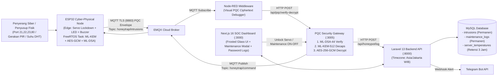

# Product Requirements Document (PRD)

**Product Name:** HoneyTrap IoT — Cyber-Physical Server Room Guard (PQC Edition)  
**Document Version:** 3.0 (Final Architecture — Cyber-Physical Sensing, Servo Auto-Lockdown, PQC Transfer Security & Maintenance Governance)  
**Date:** November 2026  

---

## 1. Executive Summary
**HoneyTrap IoT** adalah sistem keamanan ruang server terpadu (*Cyber-Physical Server Room Guard*) berbasis mikrokontroler **ESP32** yang menggabungkan teknologi jebakan siber (*Network Honeypot*) dengan pengamanan fisik ruang/rak server secara otonom (*Edge Computing*).

Di sisi siber, ESP32 menyimulasikan 4 layanan jaringan rentan (**FTP Port 21, SSH Port 22, Telnet Port 23, dan HTTP Port 80**) dengan *Fake Banner* pengendali HVAC ruang server yang menampilkan suhu nyata dari sensor. Di sisi fisik, ESP32 dilengkapi **Sensor Gerak PIR (`GPIO 32`)**, **Sensor Suhu & Kelembapan (`GPIO 4`)**, serta aktuator mekanik **Motor Servo SG90 (`GPIO 13`)** sebagai pengunci pintu rak server otomatis. Seluruh telemetri yang dikirim dari ESP32 melewati broker **EMQX Cloud** diamankan secara *end-to-end* menggunakan standar **Post-Quantum Cryptography (PQC): ML-KEM-512 + ML-DSA-44 + AES-256-GCM**, diverifikasi oleh **PQC Security Gateway**, dan dikelola melalui **Dashboard SOC Next.js bertema Frosted Glassmorphism** lengkap dengan fitur **Mode Perbaikan Berautentikasi**, **Retensi Suhu 3 Jam Terakhir**, dan **Arsip Log Forensik Berpassword**.

---

## 2. Objectives & Success Metrics
* **Respons Otonom di Edge (Online & Offline < 0.5 Detik):** Ketika terdeteksi penyusup fisik oleh sensor gerak PIR maupun serangan siber kritis (Port 22/80), ESP32 seketika memutar **Servo ke sudut `90°` (`LOCKED`)** dan membunyikan sirine bahkan saat koneksi internet terputus.
* **Keamanan Transfer Tahan Kuantum (*Post-Quantum Security*):** Mengamankan 100% paket telemetri MQTT menggunakan enkapsulasi kunci **ML-KEM-512 (FIPS 203)**, enkripsi **AES-256-GCM**, dan tanda tangan digital **ML-DSA-44 (FIPS 204)** sehingga tahan terhadap penyadapan maupun pemalsuan paket (*spoofing/tampering*).
* **Tata Kelola Operasional Ruang Server (*Maintenance & Data Retention*):**
  * Menyediakan **Mode Perbaikan (Maintenance Mode)** dengan login teknisi (Username & Password) untuk menonaktifkan sementara pemicu sensor gerak PIR selama teknisi memperbaiki server, serta mencatat audit log-nya di database.
  * Mengelola efisiensi database dengan kebijakan **Retensi Suhu 3 Jam Terakhir (*3-Hour Rolling Window*)** pada tabel `server_temperatures`, sementara seluruh log serangan (`intrusions`) dan log perbaikan (`maintenance_logs`) disimpan permanen dan diproteksi dengan *Password Gate*.

---

## 3. System Architecture & Tech Stack

### 3.1 Diagram Arsitektur End-to-End

### 3.2 Spesifikasi Komponen Teknologi
| Komponen | Teknologi Utama | Deskripsi Peran |
| :--- | :--- | :--- |
| **Edge Cyber-Physical Node** | ESP32 DevKit V1, C++, `ESP32Servo.h`, `PubSubClient`, `ArduinoJson`, `mbedtls`, `PQClean` | Menjalankan 4 port honeypot, membaca sensor PIR (`D32`) & suhu DHT (`D4`), menggerakkan kunci Servo SG90 (`D13`), mengontrol LED & Passive Buzzer (`D25, D26, D27, D14`), serta mengenkripsi paket di dalam FreeRTOS Task (`56 KB` stack). |
| **Post-Quantum Cryptography** | **ML-KEM-512** (FIPS 203), **ML-DSA-44** (FIPS 204), **AES-256-GCM** | Standar kriptografi NIST untuk pertukaran kunci sesi 256-bit, enkripsi terautentikasi (*AEAD*), dan tanda tangan digital anti-manipulasi antara ESP32 dan server. |
| **PQC Security Gateway** | Node.js v24, `@noble/post-quantum`, `crypto`, `mqtt` (Port `3005`) | Memverifikasi tanda tangan `ML-DSA-44` (menolak paket palsu dengan HTTP `403`), melakukan dekapsulasi `ML-KEM-512`, mendekripsi `AES-256-GCM`, meneruskan log ke Laravel, serta mengirim perintah `MAINTENANCE_ON/OFF` & `SAFE` ke EMQX Cloud. |
| **Cloud Broker & Debugger** | EMQX Cloud (TLS Port `8883`) & Node-RED (`127.0.0.1:1880`) | Meneruskan amplop PQC dari ESP32 serta menyediakan antarmuka *debugging* dan injeksi uji coba serangan palsu (*tampering test*). |
| **Backend & Database** | PHP 8.3+, Laravel 13, MySQL | Mengelola API telemetri, pemangkasan otomatis (*auto-pruning*) data suhu > 3 jam, autentikasi Mode Perbaikan teknisi, proteksi password arsip log, dan pengiriman notifikasi Telegram. |
| **Frontend SOC Dashboard** | Next.js 16.3, React, Tailwind CSS | Dashboard *Frosted Glassmorphism* dengan indikator kunci Servo (`LOCKED 90°` / `UNLOCKED 0°`), kartu suhu ruang server 3 jam terakhir, modal login Mode Perbaikan, dan tab arsip log berpassword. |

---

## 4. Core Features & Requirements

### 4.1 Sensor Fisik, Aktuator Servo & Layanan Umpan (ESP32)
1. **Layanan Umpan Jaringan (*Decoy Ports*):** Port `21` (FTP), Port `22` (SSH), Port `23` (Telnet dengan informasi suhu rak server & status kunci servo), dan Port `80` (HTTP Router/HVAC Admin).
2. **Deteksi Penyusupan Fisik (`PIR HC-SR501` pada `GPIO 32`):** Menggunakan deteksi *Rising-Edge (`LOW -> HIGH`)* dengan *debounce* 180ms dan *re-arming* otomatis. Saat mendeteksi gerakan (dan tidak sedang dalam Mode Perbaikan), langsung mengunci Servo ke `90°`, membunyikan sirine `CRITICAL`, dan mengirim log `PHYSICAL-PIR` (`Port 999`).
3. **Penguncian Mekanik Rak Server (`Servo SG90` pada `GPIO 13`):** Dikendalikan menggunakan pustaka `<ESP32Servo.h>` pada frekuensi PWM 50 Hz (`myServo.write(0)` untuk membuka kunci saat `SAFE`, dan `myServo.write(90)` untuk mengunci saat `CRITICAL`), dilengkapi `myServo.detach()` setelah berputar guna menjaga kestabilan arus USB.
4. **Telemetri Suhu Ruang Server (`DHT11/DHT22` pada `GPIO 4`):** Mengirimkan suhu & kelembapan rutin (`Port 997`) serta peringatan *Thermal Anomaly* (`Port 998`, level `WARNING`) apabila suhu melebihi `35.0°C`.

### 4.2 Keamanan Transfer Post-Quantum (ML-KEM + ML-DSA + AES-256-GCM)
* Setiap paket keluar dibungkus dalam amplop JSON Base64 (`kem_ct`, `iv`, `aes_ct`, `tag`, `sig`) berukuran ~4.6 KB melalui buffer MQTT `8192` byte.
* PQC Gateway wajib menolak setiap paket yang gagal melewati verifikasi tanda tangan `ML-DSA-44` atau *authentication tag* `AES-256-GCM` dengan status `403 Forbidden`.

### 4.3 Mode Perbaikan (Maintenance Mode), Retensi Suhu 3 Jam & Proteksi Log
* **Mode Perbaikan Ruang Server:** Teknisi wajib memasukkan Username, Password, dan catatan perbaikan pada Dashboard. Saat aktif, perintah `MAINTENANCE_ON` dikirim ke ESP32 untuk menonaktifkan pemicu sensor PIR, dan aksi tersebut dicatat pada tabel `maintenance_logs`.
* **Retensi Suhu 3 Jam Terakhir:** Tabel `server_temperatures` secara otomatis menghapus rekaman yang berusia lebih dari 3 jam (`created_at < now()->subHours(3)`).
* **Proteksi Password Arsip Log:** Tab *Forensic Logs* di Dashboard dikunci dengan autentikasi password sebelum menampilkan tabel *Maintenance Audit Logs* dan *Forensic Intrusion Archive*.
