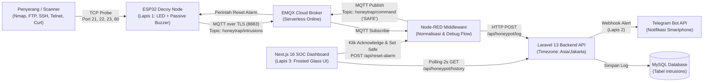

# Product Requirements Document (PRD)

**Product Name:** HoneyTrap IoT (Sistem Honeypot & Deteksi Intrusi Jaringan Lokal Berbasis ESP32 & Cloud MQTT)  
**Document Version:** 2.0 (Final Architecture — EMQX Cloud, Node-RED Bridge, Bidirectional Control & Frosted Glassmorphism SOC)  
**Date:** November 2026  

---

## 1. Executive Summary
**HoneyTrap IoT** adalah sistem keamanan siber defensif (*deception technology*) berbiaya rendah dan berdaya rendah yang memposisikan mikrokontroler **ESP32** sebagai perangkat umpan (*decoy sensor*) di dalam jaringan Wi-Fi lokal. Sistem ini membuka dan menyimulasikan *port* layanan jaringan yang tampak rentan (**FTP Port 21, SSH Port 22, Telnet Port 23, dan HTTP Port 80**) lengkap dengan *fake banner grabbing* untuk memancing, menjebak, serta merekam jejak digital penyerang (alamat IP, port sasaran, dan *raw payload* eksploitasi).

Pada revisi arsitektur v2.0 ini, telemetri serangan dikirim secara terenkripsi melalui **EMQX Cloud (MQTT over TLS Port 8883)**, dijembatani dan dinormalisasi oleh **Node-RED**, lalu diproses oleh **Backend Laravel** untuk disimpan ke basis data relasional serta didistribusikan melalui **Sistem Peringatan 3 Lapis (3-Tier Alerting System)** dan dikendalikan secara dua arah (*bidirectional*) melalui **Dashboard Web Next.js bertema Frosted Glassmorphism**.

---

## 2. Objectives & Success Metrics
* **Deteksi & Respons Real-Time (< 2 Detik):** Menangkap paket anomali pada *socket* ESP32, memicu alarm fisik lokal seketika, dan menampilkan insiden pada dasbor web serta Telegram dalam waktu kurang dari 2 detik.
* **Kendali Dua Arah (Bidirectional SOC Control):** Memungkinkan administrator mematikan alarm fisik (LED & Buzzer pada ESP32) baik secara lokal melalui tombol perangkat keras maupun secara jarak jauh melalui tombol **Acknowledge & Set Safe** pada dasbor web.
* **Ketahanan Perangkat Keras (Hardware Resilience):** Mencapai *uptime* tinggi dengan perlindungan **Watchdog Timer (`esp_task_wdt`)** berbatas 15 detik, *timeout* handshake TLS 5 detik, dan pembatasan maksimum 3 koneksi klien simultan per port untuk mencegah serangan *Denial of Service* (DoS / *SYN Flood*) atau *Out of Memory* (OOM).
* **Akurasi Forensik & Zona Waktu Lokal:** Mencatat minimal 90% *payload* serangan secara terstruktur di MySQL dengan penyesuaian zona waktu lokal **WIB (`Asia/Jakarta`)** untuk keabsahan audit forensik.

---

## 3. System Architecture & Tech Stack

### 3.1 Diagram Alur Arsitektur End-to-End

### 3.2 Spesifikasi Komponen Teknologi
| Komponen | Teknologi Utama | Deskripsi Peran |
| :--- | :--- | :--- |
| **Edge IoT (Honeypot Node)** | ESP32-WROOM-32, C++ (Arduino IDE), `PubSubClient`, `ArduinoJson` | Membuka 4 soket layanan umpan, melakukan *banner grabbing* palsu, mengekstrak *payload*, mengelola alarm fisik Lapis 1 (LED Hijau, Kuning, Merah & *Passive Buzzer*), serta berkomunikasi dua arah via TLS MQTT. |
| **Cloud Message Broker** | EMQX Cloud (MQTT over TLS Port 8883) | Broker pesan terkelola (*cloud*) yang menjamin pengiriman telemetri intrusi (`honeytrap/intrusions`) dan perintah kendali (`honeytrap/command`) secara aman dengan autentikasi *username/password*. |
| **IoT Middleware & Debugger** | Node-RED (`127.0.0.1:1880`) | Menjembatani aliran protokol MQTT dari EMQX Cloud ke REST API Laravel, menyediakan injeksi simulasi pengujian, memantau paket *raw* secara visual, dan meneruskan sinyal reset alarm dari web ke ESP32. |
| **Backend & REST API** | PHP 8.3+, Laravel 13 | Menyediakan endpoint `POST /api/honeypot/log` dan `GET /api/honeypot/history`, memvalidasi data intrusi, menyimpan ke MySQL, dan menembakkan peringatan ke Telegram Bot API. |
| **Database** | MySQL | Menyimpan catatan historis serangan (`id`, `attacker_ip`, `target_port`, `raw_payload`, `created_at`, `updated_at`) untuk kebutuhan forensik digital. |
| **Frontend SOC Dashboard** | Next.js 16.3 (Turbopack), React, Tailwind CSS | Antarmuka *Security Operations Center* (SOC) bertema **Frosted Glassmorphism** dengan *polling* 2 detik, indikator kedaruratan layar penuh (*Panic/Siren Mode*), analitik distribusi port, terminal serial *live*, dan arsip forensik. |

---

## 4. Core Features & Requirements

### 4.1 Modul Firmware ESP32 (Decoy & Capture)
* **Simulasi 4 Layanan Rentan (*Fake Banner Grabbing*):**
  * **Port 21 (FTP):** Mengirimkan banner `220 (vsFTPd 3.0.3)` dan balasan `530 Login incorrect.`
  * **Port 22 (SSH):** Mengirimkan banner `SSH-2.0-OpenSSH_8.2p1 Ubuntu-4ubuntu0.5` dan balasan `Permission denied (publickey,password).`
  * **Port 23 (Telnet):** Mengirimkan prompt `Ubuntu 20.04.6 LTS - honeytrap-iot login:` dan balasan `Login incorrect`.
  * **Port 80 (HTTP):** Mengirimkan header jebakan `HTTP/1.1 401 Unauthorized` dengan identitas server `Apache/2.4.41 (Ubuntu)` dan `WWW-Authenticate: Basic realm="Router Admin"`.
* **Akuisisi Payload Cepat:** Membaca hingga 200 karakter pertama yang dikirim penyerang dalam jendela waktu 1.5 detik sebelum menutup koneksi secara bersih.

### 4.2 Sistem Peringatan 3 Lapis (3-Tier Alerting System)
1. **Lapis 1 — Peringatan Fisik Lokal (ESP32 Actuator):**
   * **Status `SAFE` (Aman):** **LED Hijau (`GPIO 25`)** menyala statis, buzzer nonaktif.
   * **Status `WARNING` (Waspada — Port 21 FTP / Port 23 Telnet):** **LED Kuning (`GPIO 26`)** menyala disertai 1x bunyi *beep* peringatan (`1800 Hz`, 150ms) pada *Passive Buzzer*.
   * **Status `CRITICAL` (Bahaya — Port 22 SSH / Port 80 HTTP):** **LED Merah (`GPIO 27`)** berkedip cepat setiap 250ms diiringi sirine darurat dua nada (`2800 Hz` dan `1800 Hz`) pada **Passive Buzzer (`GPIO 14`)**. Alarm fisik mengunci status tertinggi hingga di-reset melalui tombol fisik **`BOOT` (`GPIO 0`)** atau perintah jarak jauh dari dasbor web.
2. **Lapis 2 — Peringatan Jarak Jauh Instan (Telegram Bot API):**
   * Setiap kali log baru masuk ke endpoint Laravel, sistem langsung mengirim pesan peringatan darurat ke grup/kanal Telegram berisi IP Penyerang, Port Sasaran, dan *Raw Payload*.
3. **Lapis 3 — Pemantauan Visual & Forensik Historis (Next.js Dashboard):**
   * **Mode Visual Darurat (*Tense Emergency Glass Frame*):** Saat terdeteksi serangan baru bertingkat `WARNING` atau `CRITICAL`, latar belakang *mesh* dan bingkai layar dasbor otomatis berubah menjadi Oranye (`WARNING`) atau Merah Menyala (`CRITICAL`) yang berdenyut hingga administrator menekan tombol **Acknowledge & Set Safe**.
   * **Analitik & Telemetri Langsung:** Menampilkan total serangan, jumlah insiden kritis, grafik proporsi 4 port teratas, inspektur insiden terakhir dalam zona waktu **WIB**, tabel log paket langsung, dan *stream* terminal serial (`sensor-feed.tty1`).
   * **Arsip Forensik Digital:** Menyediakan pencarian berdasarkan alamat IP/potongan eksploitasi, penyaringan port spesifik, dan penyaringan tanggal kejadian.

---

## 5. Security & Mitigation (Resource Protection)
* **Konfigurasi Ulang Watchdog Timer (`esp_task_wdt_reconfigure`):** Mengawasi *main loop* pada ESP32 dengan batas waktu 15 detik dan melakukan *reset* berkala selama pembacaan *socket* maupun koneksi Wi-Fi.
* **Pembatasan Timeout TLS (`setTimeout(5)`):** Mencegah kebekuan proses (*blocking*) saat melakukan *handshake* TLS ke broker EMQX Cloud pada kondisi jaringan tidak stabil.
* **Limitasi Koneksi Soket (`MAX_CLIENTS = 3`):** Setiap objek `WiFiServer` dibatasi maksimal melayani 3 koneksi secara bersamaan guna menjaga ketersediaan *heap memory* ESP32 dari serangan *flooding*.
